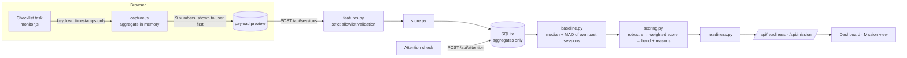

# Crew Readiness: Full Execution Plan

**NASA Space Apps 2026 · Team Lead document · all times Azerbaijan (UTC+4)**

> **Team rule:** a clear, working, honest prototype is the target. We earn credibility through the end-to-end data flow, careful language, and a demo that judges understand in one minute.

Related: [Team Guide](TEAM_GUIDE.md) (start here if you're a teammate) · [Data Contract](DATA_CONTRACT.md) · [Test Log](TEST_LOG.md)

---

## 1. The product in one paragraph

A web app that watches **how** an astronaut works through routine simulated checklist tasks (timing only, never content), compares it with **that person's own** usual pattern, and shows an **explainable readiness indicator** to a human reviewer before a critical operation such as docking. It **supports** decisions; it does not diagnose fatigue, clear anyone for duty, or control the mission.

### What we claim vs. what we never claim

| ✅ We say | ❌ We never say |
|---|---|
| "detects changes in task interaction timing" | "detects fatigue / impairment / cognitive decline" |
| "compared with their own baseline" | "compared with normal people" |
| "may merit a check-in" | "unfit for duty", "grounded", "cleared" |
| "illustrative thresholds", "prototype logic" | "NASA-approved", "clinically validated", "X % accurate" |
| "feasibility demonstration with N teammates" | "validated", "proven" |

---

## 2. The demo story (our north star)

Everything we build must serve these 3 minutes. If a feature doesn't appear here, it's a stretch.

| Time | What we show | What judges should understand | Built? |
|---|---|---|---|
| 0:00–0:25 | Docking is in 6 h. Passive monitoring avoids interrupting routine work. | Clear mission problem and relevance | Mission page ✅ |
| 0:25–1:05 | Pilot completes the simulated pre-docking checklist. **"This JSON is everything that leaves the browser."** | Privacy by design, working capture | ✅ |
| 1:05–1:45 | Dashboard: pilot vs. **own** baseline → YELLOW with plain-language reasons + evidence table + trend | Personalised, interpretable analysis | ✅ |
| 1:45–2:20 | Run the short attention check (or show its result). System requests human review, never auto-action. | Responsible verification and limits | ⬜ A-1 |
| 2:20–3:00 | Mission view suggests a second verification / backup pilot. Close with scope limits. | Actionable decision support, not a medical claim | ⬜ L-1 |

---

## 3. Scope: MVP first, then gated stretch

**Gate rule:** nobody starts a stretch item until the MVP integration check (§7, Checkpoint C2) passes on `main`.

| MVP (ship first) | Status | Stretch (only if MVP is stable) | Status |
|---|---|---|---|
| Simulated checklist with aggregate timing capture | ✅ skeleton | Reaction-time attention check (A-1) | ⬜ frame + spec |
| Per-person baseline + CALIBRATING state | ✅ skeleton | Mission role-reassignment advisory (L-1) | ⬜ spec tests |
| Explainable GREEN/YELLOW/RED view with reasons | ✅ skeleton | Isolation Forest comparison with sample-size warning (M-3) | ⬜ |
| One critical-operation context + trend chart | ✅ skeleton | Forecast, labelled **simulated** unless evaluated | ⬜ probably cut |
| Real baseline from team sessions (V-2) | ⬜ | Public deployment (L-4) | ⬜ |
| False-alarm check of our thresholds (M-2) | ⬜ | | |

"✅ skeleton" means it works end to end but is the simplest honest version. The owner is expected to understand it, challenge it, and improve it.

---

## 4. Architecture

| Layer | Choice | Why |
|---|---|---|
| App | Python + Flask | One process, one command, everyone can read it |
| UI | HTML + CSS + vanilla JS modules | Direct access to precise browser timing; no build step to break |
| Data | SQLite (file in `instance/`) | Zero setup; enough for a hackathon |
| Analysis | NumPy (scikit-learn optional) | Transparent statistics first, ML second |
| Charts | Chart.js 4.4.1, **vendored** in `app/static/vendor/` | Works with no internet at the venue |
| Tests | pytest | Protects privacy rules and the demo story |

Module ownership is in the [Team Guide](TEAM_GUIDE.md#3-codebase-tour).

---

## 5. Decisions log

Each decision: what, why, who signs off. **Status: DECIDED / PROPOSED (needs sign-off) / OPEN.**

| ID | Decision | Rationale | Owner | Status |
|---|---|---|---|---|
| D-1 | Flask + vanilla JS + SQLite + NumPy + vendored Chart.js | From original plan; minimal moving parts | Lead | DECIDED |
| D-2 | Features computed **in the browser**; server accepts only 9 aggregate numbers and rejects anything else (HTTP 400) | Privacy is enforced and testable, not promised. Raw keystrokes never exist on the server | Lead | DECIDED (prototype) |
| D-3 | Baseline = median + MAD (×1.4826) of the last ≤ 20 `ok` sessions; **CALIBRATING below 5** | Robust to one-off weird sessions with tiny n | Member 2 | PROPOSED |
| D-4 | One-sided deviation (only slower / more pausing counts), cap 4, weights 40/30/30, cutoffs 1.0 / 2.0 | Simple and explainable. **Needs M-2 evidence before we defend it to judges** | Member 2 | PROPOSED |
| D-5 | **What counts as an alert?** Which bands on which roles escalate, and when do we suggest the backup? | This is a product decision, not a math one. Rules in the **D-5 rules** table below | **Lead** | **DECIDED** (4 cases; open edges listed below), unblocks L-1 |
| D-6 | Demo astronaut = fictional Pilot "Kai Okafor"; critical op = manual docking at T-6h | Highest-stakes, easy to understand | Lead | PROPOSED |
| D-7 | **Live demo strategy:** who types on stage, on which profile, against which baseline? | A live typist compared with a *synthetic* baseline is meaningless (see R-1 below) | **Lead** | **OPEN** |
| D-8 | Public link: hosted vs. "runnable repo + video" | Submission needs one of them. A Vercel deployment now exists (read-only-ish: SQLite lives in `/tmp`, so submitted sessions are **not durable**; see README → Deploy). Keep it as a viewing link, or invest in a durable DB? | Lead | OPEN (interim: Vercel viewing link) |
| D-9 | **Visual direction: International Typographic (Swiss) style on the dark ground**: 12-column grid, one typeface (Inter), flush-left, rules instead of boxes, colour only for flagged states. Chosen by the Lead from five researched options; Boldcase (editorial/bento) could not be read from the build environment | A calm, credible tone suits "a human reviews this before docking"; it is cheap to render, accessible and offline-safe. Full rationale and history in `docs/DESIGN.md` | Lead | **TRIAL** on branch; merge when approved |

### D-5 rules: what counts as an alert (decided by the Lead)

The mission advisory is driven by **critical roles only**. Level = the highest row that applies.

| Situation (critical roles) | Level | The advisory must say |
|---|---|---|
| Any critical member is **RED** | `REVIEW` | Recommend human review and a second verification. If another critical member is **GREEN**, name them as an option *for the reviewer to consider* |
| No RED, any critical member **YELLOW** | `CHECK_IN` | Suggest a brief check-in or the optional attention check for that person |
| No RED/YELLOW, any critical member **CALIBRATING** / no data | `CHECK_IN` | No baseline yet; "unknown" is never presented as "fine" |
| All critical members **GREEN** | `NOMINAL` | No action suggested |
| **No clean backup** (e.g. pilot RED, backup YELLOW) | `REVIEW` | Flag **both**; name **nobody** as a replacement; humans decide who covers |
| Any **non-critical** role, any band | no effect | Shown in the assignments table only; never changes the level |

**Open edges: settled when L-1 was implemented** (by the assistant, as delegated by the Lead; **the Lead may overrule any of these**, and the tests in `tests/test_mission.py` then change with the decision):
- **Primary GREEN, backup RED:** a RED backup alone forces `REVIEW` (the table's "any critical RED"). The message names the RED person and role, and the GREEN primary may be named as an option for the reviewer.
- **One critical member RED, another CALIBRATING:** `REVIEW`. The CALIBRATING member is reported as unknown ("No baseline yet ... unknown, not fine") and is never named as an option, because an unknown person is not a clean backup. With nobody GREEN, nobody is named as cover.
- **LOW confidence:** never softens the level (safety first). It adds a caveat to the wording ("Few sessions so far, so lower confidence.").
- **"Names nobody as a replacement"** is pinned as: no suggested action contains replacement words (replace, instead, cover, option, consider, swap, take over, assign), and both flagged people appear only as people to review.

> **Recommendation for D-7 (Lead decides):** the presenter creates a `team_test` profile and records ≥ 5 real sessions **on the demo laptop** on Nov 14 evening. On stage, a deliberate perturbation (e.g. non-dominant hand) produces a visible, honest deviation. The seeded fictional crew remains as the context and as the fallback.

---

## 6. Timeline (Azerbaijan time)

The skeleton puts us **ahead** of the original plan: the app shell, monitoring task and first end-to-end path already run. We reinvest that time into *real data and evidence*, which is what makes the pitch credible.

| When | Objective | Exit check (must be true to move on) |
|---|---|---|
| **Nov 14 12:00–13:00** | Scope, roles, repo, data contract, UI sketch | ✅ Skeleton on GitHub; everyone has a task ID |
| **13:00–13:45** | **Onboarding:** everyone clones, runs, reads the Team Guide, answers the comprehension questions | Every laptop: app runs, `pytest` green |
| **13:45–17:00** | Role tracks: L-0, L-1, D-5/D-7 · M-1, M-2 · F-1 · R-1, V-1 | Each teammate has a `team_test` profile with ≥ 2 real sessions; D-5 decided |
| **17:00–21:00** | Integration: real baselines (≥ 5 sessions each), L-1 merged, F-2, M-2 results in Decisions | **C2: MVP works end to end on real data for at least one person** |
| **21:00–23:00** | Fix integration, freeze demo data, record **backup screen capture** | Recording exists on two laptops + cloud |
| **Nov 15 08:00–11:00** | Stretch **only if C2 passed:** A-1 attention check, M-3 Isolation Forest | **11:00 feature freeze** on anything unstable |
| **11:00–16:00** | V-2 validation session, R-2 sources, charts, polish, V-3 claims audit | Every claim has a supporting note or qualifier |
| **16:00–19:00** | README final, screenshots, demo video, pitch rehearsal × 3 | Full offline rehearsal passes |
| **19:00–21:30** | Upload, verify, submit | Submitted before **21:30** internal deadline; whole team opened it |
| **21:30–23:59** | Emergency buffer only | No new features; essential corrections only |

---

## 7. Integration checkpoints

| ID | When | Check | Who verifies |
|---|---|---|---|
| C0 | 13:45 | Every laptop runs `python run.py` and `python -m pytest` green | Lead |
| C1 | 17:00 | `main` builds clean; a real session from each teammate is visible on the dashboard | Lead |
| C2 | 21:00 | Full demo story steps 1–3 work on **real** data from a clean DB; `pytest` green | Lead + Member 4 |
| C3 | Nov 15 11:00 | Feature freeze. Stretch merged or cut, no half-states on `main` | Lead |
| C4 | Nov 15 19:00 | Fresh clone on a different laptop → all routes work; video plays; README complete | Member 4 |

---

## 8. Task board

Detailed task cards (goal, files, acceptance criteria, hints) are in the [Team Guide §6](TEAM_GUIDE.md#6-your-first-tasks). Copy each row into a GitHub issue with its ID in the title.

| ID | Task | Owner | Window | Depends on |
|---|---|---|---|---|
| L-0 | Repo hygiene: merge skeleton to `main`, protect `main`, create issues from this board | Lead | 13:00–13:45 | none |
| L-1 | Implement `mission_advisory()` to spec tests | Lead | 14:00–19:00 | D-5 |
| L-2 | Sign off D-3…D-8 | Lead | by 17:00 | M-1, M-2 |
| L-3 | Pitch script + demo run-sheet | Lead | Nov 15 | C2 |
| L-4 | (Optional) public deployment | Lead | Nov 15 morning | C2 |
| M-1 | Own the scoring: review, challenge, document | Member 2 | 13:45–15:30 | none |
| M-2 | False-alarm simulation → evidence for cutoffs | Member 2 | 15:30–19:00 | M-1 |
| M-3 | *Stretch:* Isolation Forest as secondary signal | Member 2 | Nov 15 08:00–11:00 | C2 |
| F-1 | Monitoring + dashboard UX pass ("judge completes without explanation") | Member 3 | 13:45–17:00 | none |
| F-2 | Trend chart + evidence readability | Member 3 | 17:00–21:00 | F-1 |
| F-3 | Responsive + accessibility check | Member 3 | Nov 15 11:00–14:00 | F-2 |
| A-1 | *Stretch:* reaction-time attention check | Member 4 (Member 3 if 3 people) | Nov 15 08:00–11:00 | C2 |
| R-1 | Complete "Privacy & limits" page | Member 4 | 13:45–17:00 | none |
| R-2 | Sources: NASA resources + research, each with "how it informed us" | Member 4 | Nov 15 11:00–16:00 | none |
| V-1 | Write validation protocol + set up Test Log | Member 4 | 13:45–15:00 | none |
| V-2 | Run validation sessions, log results honestly | Member 4 + all | Nov 14 17:00 → Nov 15 14:00 | V-1 |
| V-3 | Claims audit of all UI copy, README, slides, video | Member 4 | Nov 15 15:00–17:00 | none |

**If we are three:** Lead keeps L-*, plus V-3 and R-1 in short review blocks. Member 2 owns M-*. Member 3 owns F-* and A-1. Everyone contributes sessions to V-2.

---

## 9. Validation plan (feasibility, not validation)

Goal: show the pipeline **can** detect a deliberate change in an individual's timing, and report honestly how noisy it is.

1. **Protocol first (V-1):** written before any session, in `docs/TEST_LOG.md`.
2. **Baseline:** each teammate, own `team_test` profile, ≥ 5 normal sessions, **same laptop and keyboard**, logged with time of day.
3. **Perturbation:** one session with a known, harmless change (non-dominant hand, or a simultaneous mental-arithmetic task). Pre-register what you expect to see.
4. **Report:** participants (N), sessions each, how many perturbed sessions moved to YELLOW/RED, how many normal sessions did (false alarms), confounders.
5. **Language:** "In a small internal feasibility test (N = 4, ~6 sessions each), a deliberate perturbation shifted the score in X of 4 cases." Nothing stronger.

---

## 10. Risks and mitigations

| # | Risk | Likelihood | Mitigation | Owner |
|---|---|---|---|---|
| R-1 | Live typist is compared with a synthetic baseline, so the result means nothing | High if ignored | D-7: real baseline on the demo laptop | Lead |
| R-2 | Different keyboard/laptop changes timing and makes the baseline invalid | High | Record baseline on the demo machine; note it as a confounder | Member 4 |
| R-3 | False alarms (one synthetic session already hits ~2.0 by chance; see Kai's trend on Nov 7) | Medium | M-2 simulation; quote the false-alarm rate honestly | Member 2 |
| R-4 | Overclaiming in UI, slides or video | Medium | Language table §1, V-3 audit, banned-word test | Member 4 |
| R-5 | Late integration breaks `main` | Medium | Small PRs, `pytest` before merge, freeze at 11:00 | Lead |
| R-6 | Venue Wi-Fi fails | Medium | No external calls (Chart.js vendored); backup video | Lead |
| R-7 | Teammate blocked on setup (Windows, Python version) | Medium | Team Guide §2; pair for 10 min, don't suffer alone | Lead |
| R-8 | Scope creep ("let's add an LLM / a 3D globe") | High | Gate rule §3. If it's not in the demo story, it waits | Lead |

---

## 11. Judge Q&A prep

Each owner prepares a 2-sentence answer **in their own words**, pointing at evidence in the app. Don't memorise a script; understand the reason.

| Likely question | Who answers | Evidence to point at |
|---|---|---|
| "Does this detect fatigue?" | Lead | §1 claim table; disclaimer on every view |
| "Why not machine learning?" | Member 2 | n is tiny; explainability; M-3 as secondary signal |
| "Why median/MAD instead of mean/SD?" | Member 2 | `baseline.py` docstring; outlier test |
| "How often does it raise a false alarm?" | Member 2 | M-2 result |
| "What exactly do you store?" | Member 3 | Live payload preview; server rejects text (`test_privacy_*`) |
| "Wouldn't anyone be slower on a new keyboard?" | Member 4 | Confounders list; CALIBRATING + confidence |
| "How would this work on the ISS / Gateway?" | Lead | Passive capture inside existing procedure software; on-device aggregation; human in the loop |
| "What did your testing show?" | Member 4 | Test Log; feasibility, not validation |

---

## 12. Before we press submit

- [ ] Public link or runnable repo; all routes work from a **fresh clone** and empty `instance/`
- [ ] README: problem, solution, architecture, setup, data handling, demo steps, limitations, sources
- [ ] Demo video (≤ 3 min) + backup copy; no live network dependency
- [ ] Screenshots: monitoring → payload → dashboard → mission advisory
- [ ] Every NASA resource / dataset / paper named with **how** it informed us (R-2)
- [ ] No unsupported health or NASA-approval claims (V-3 passed)
- [ ] Fictional crew and illustrative thresholds labelled everywhere
- [ ] Whole team opened the final submission before **21:30**

## D-9: missed check-in watchdog (plan v3, H2) - recorded 2026-11-15, Lead may overrule
- A check-in is a submitted session (a timestamp we already store); nothing new is collected.
- The longest agreed gap is `check_in_interval_hours = 36` in `app/mission.py`: an **illustrative assumption**, not a rule.
- It applies to every assigned role (a missed check-in is a safety matter regardless of role), but it is **separate from the readiness advisory**, which it never changes (D-5: non-critical roles never move the level).
- No check-in ever recorded counts as overdue. A timestamp in the future, or one that cannot be read, is a clock problem: reported as such, never as overdue, never with negative hours.
- Wording: it suggests looking in on the person, says nothing is necessarily wrong, and never uses the words unconscious, fatigue, impaired, unfit or diagnosis. It is not a consciousness or health measure.
